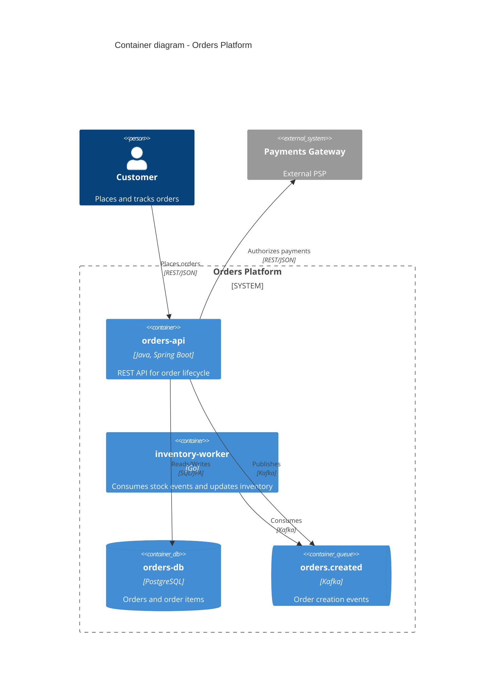
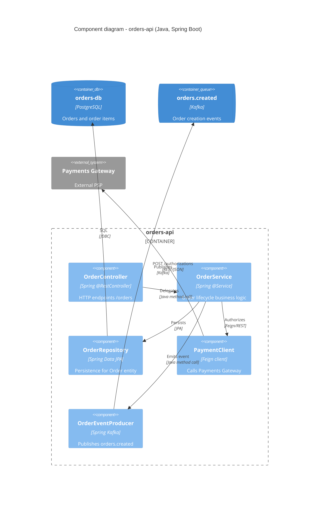

# Mermaid C4 Syntax Reference

Reference for writing C4 diagrams in Mermaid (`C4Context`, `C4Container`, `C4Component`). Read this before generating the diagrams in `architecture.md`.

## Contents

- Diagram types
- Element declarations
- Relations
- Layout and styling
- Full example
- Common pitfalls

## Diagram types

Each Mermaid C4 block starts with one of:

```
C4Context      %% System Context diagram
C4Container    %% Container diagram
C4Component    %% Component diagram
```

Always include a title with `title <text>` on the next line.

## Element declarations

```
Person(alias, "Label", "Optional description")
System(alias, "Label", "Description")
System_Ext(alias, "Label", "Description")          %% external system
SystemDb(alias, "Label", "Description")            %% database (context level)
SystemQueue(alias, "Label", "Description")         %% queue/topic

System_Boundary(alias, "Label") { ... }            %% groups systems
Enterprise_Boundary(alias, "Label") { ... }

Container(alias, "Label", "Technology", "Description")
ContainerDb(alias, "Label", "Technology", "Description")
ContainerQueue(alias, "Label", "Technology", "Description")
Container_Ext(alias, "Label", "Technology", "Description")
Container_Boundary(alias, "Label") { ... }         %% e.g. one per deployable app

Component(alias, "Label", "Technology", "Description")
ComponentDb(alias, "Label", "Technology", "Description")
ComponentQueue(alias, "Label", "Technology", "Description")
Component_Ext(alias, "Label", "Technology", "Description")
```

Rules:

- `alias` must be a valid identifier (letters, digits, `_`); use the real component name in camel/snake case, e.g. `orderController`.
- The label should be the real class/struct/application name from the code; the technology slot carries framework/language (`Java, Spring Boot`, `Go, Gin`, `PostgreSQL`, `Kafka`).
- External systems use the `_Ext` variants.
- Nest elements inside a `*_Boundary` block to group them.

## Relations

```
Rel(fromAlias, toAlias, "Label")
Rel(fromAlias, toAlias, "Label", "Technology/Protocol")
BiRel(a, b, "Label", "Protocol")
Rel_U(from, to, "Label")      %% directional helpers: _U _D _L _R
Rel_Back(from, to, "Label")
UpdateRelStyle(from, to, $offsetY="-20")   %% optional styling
```

Rules:

- Every relation should state the protocol in the 4th argument: `REST/JSON`, `gRPC`, `Kafka topic: orders.created`, `SQL/JDBC`, `JPA`, etc.
- Direction of `Rel` is data flow / call direction (caller → callee).
- Use the exact alias declared for each element; undeclared aliases in `Rel` break rendering.

## Layout and styling

```
Lay_Distance(a, b, 2)          %% hint for spacing
UpdateElementStyle(alias, $bgColor="#438DD5", $fontColor="#ffffff")
UpdateLayoutConfig($c4ShapeInRow="3", $c4BoundaryInRow="1")
```

Use styling sparingly — only when a diagram is hard to read otherwise.

## Full example

````

````

````

````

## Common pitfalls

- **Undeclared alias in `Rel`**: every alias used in a relation must be declared first — the diagram fails to render otherwise.
- **Special characters in labels**: keep labels in double quotes; avoid unescaped `"` inside labels.
- **Duplicate aliases across boundaries**: aliases are global within a diagram, even inside different boundaries.
- **Overloaded diagrams**: beyond ~20 nodes, split the component diagram by layer (API / application / infrastructure) or by functional area, one Mermaid block each.
- **Tags on relations**: when the same pair communicates through several channels, use multiple `Rel` lines (one per protocol) instead of a single generic one.
