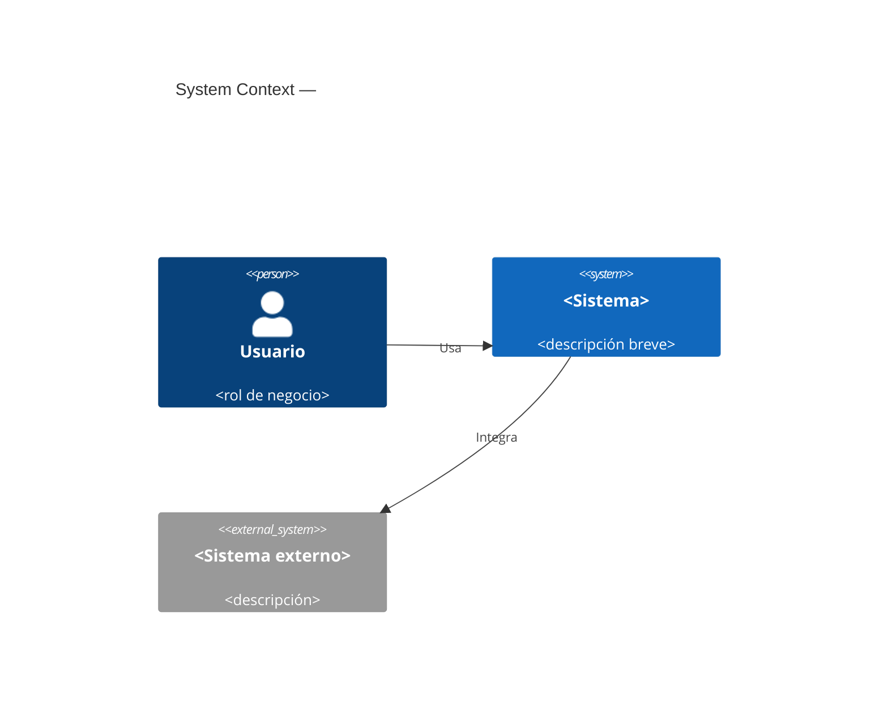
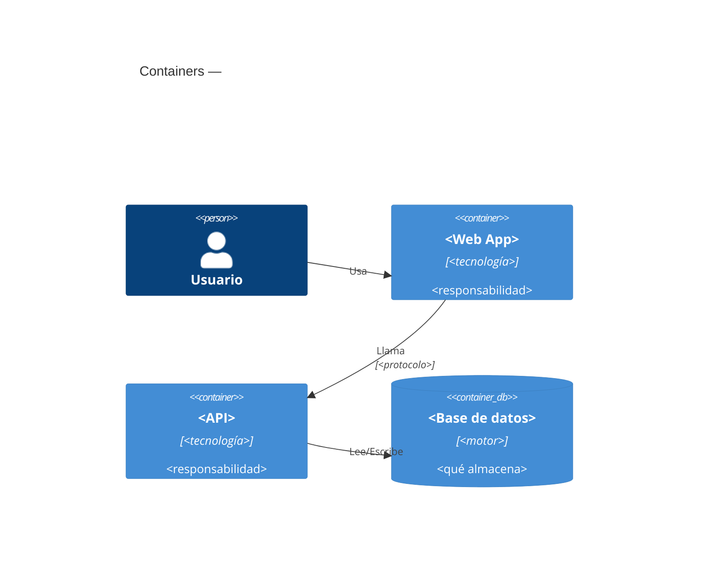
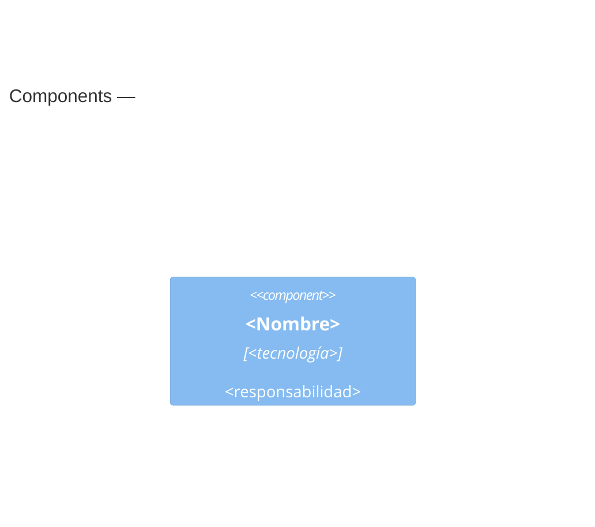

# Plantilla de RFC

Leer esta plantilla al redactar un RFC en la fase Define. Adaptar las secciones, pero mantener siempre las marcadas como obligatorias.

```markdown
# RFC-XXX: <Título de la propuesta>

| Campo | Valor |
|---|---|
| Estado | PENDING_REVIEW |
| PRD origen | <enlace/nombre del PRD aprobado> |
| Rol | Software Architect |
| Fecha | <YYYY-MM-DD> |
| Versión | <ej. 0.1> |

## 1. Contexto y problema (obligatoria)

Resumen del PRD en lenguaje del negocio: qué problema se resuelve, funcionalidad
deseada y métricas objetivo. Referenciar el PRD, no copiarlo.

## 2. Contexto técnico actual (obligatoria si el proyecto existe)

Estado actual del sistema relevante para esta propuesta: arquitectura existente,
stack vigente y documentación consultada. Si el proyecto no tenía documentación,
referenciar la documentación base construida previamente.

## 3. Arquitectura de la solución — C4 (obligatoria)

### Nivel 1 — System Context



### Nivel 2 — Containers



### Nivel 3 — Components (solo donde aporte valor)



## 4. Stack y tecnologías (obligatoria)

| Capa / necesidad | Tecnología elegida | Justificación |
|---|---|---|
| Lenguaje | | |
| Framework | | |
| Persistencia | | |
| Mensajería / async | | |
| Infraestructura | | |
| Proveedores externos | | |

## 5. Diseño de la solución (obligatoria)

Flujo principal de la solución descrito con lenguaje ubicuo + técnico:
componentes involucrados, interacciones, contratos relevantes (APIs, eventos),
y decisiones de diseño clave con sus alternativas descartadas.

## 6. Problemas y riesgos (obligatoria)

| Riesgo | Tipo (técnico/negocio/operativo) | Probabilidad | Impacto | Mitigación |
|---|---|---|---|---|

## 7. Plan de rollout (obligatoria)

Estrategia de despliegue: feature flags / canary / blue-green, entornos,
orden de liberación, criterios de avance y monitoreo durante el rollout.

## 8. Plan de rollback (obligatoria)

Estrategia de reversa: cómo se desactiva o revierte, reversibilidad de
migraciones de datos, kill switch, criterios que disparan el rollback y
responsable de la decisión.

## 9. Alternativas consideradas

Otras propuestas evaluadas (pueden tener su propio RFC) y por qué se
descartaron. Recordatorio: solo 1 RFC por PRD puede quedar APPROVED.

## 10. Preguntas abiertas

Decisiones aún no resueltas que NO bloquean la aprobación (las que bloquean
deben resolverse antes de pasar a IN_REVIEW).

## Historial de estados

| Fecha | Estado | Comentario |
|---|---|---|
| | PENDING_REVIEW | Creación |
```
