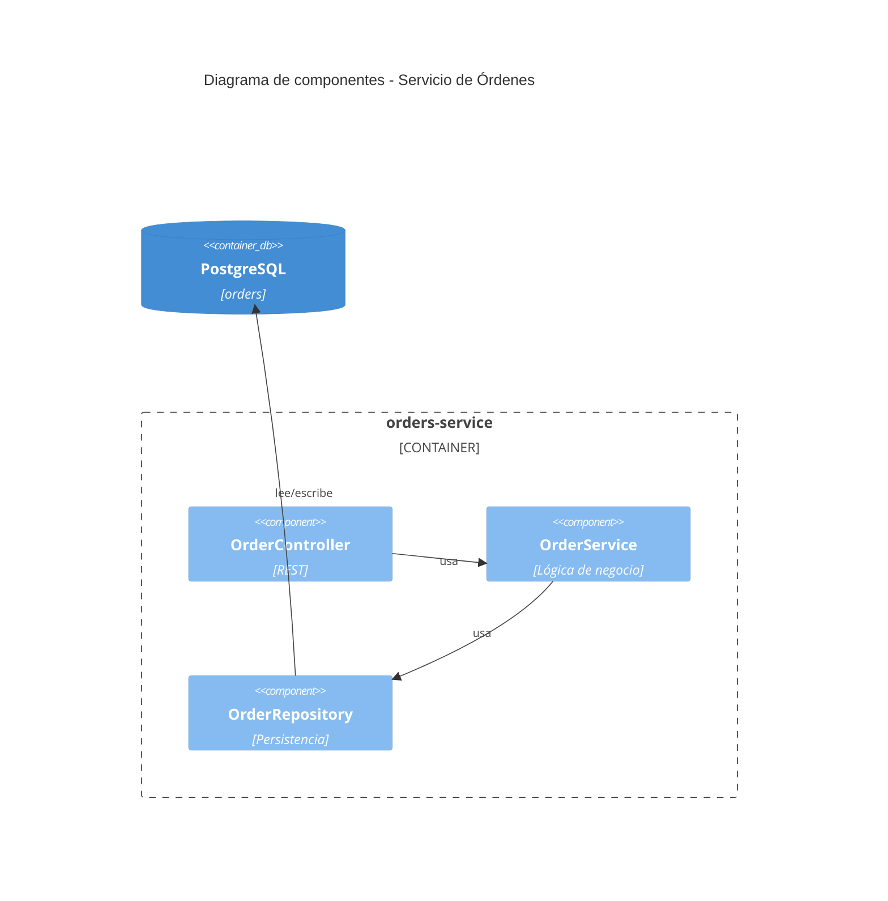

# SDLC Specify (SPECS)

## Contexto del flujo

Flujo SDLC basado en SDD: `discovery -> define -> specify -> plan -> implement`.

- Entrada: RFC aprobado (salida del Define). Solo un RFC puede estar APPROVED por PRD.
- Salida: documento(s) SPECS. **Puede haber varios SPECS por RFC: uno por proyecto** cuando el RFC indica construir/modificar múltiples proyectos.
- Rol: Tech Lead. El lenguaje es **puramente técnico**.
- Estados del documento: `PENDING_REVIEW -> IN_REVIEW -> APPROVED | REJECTED`. Toda SPECS nueva se crea en `PENDING_REVIEW`.

Objetivo: dejar la solución técnica completamente detallada **sin ninguna decisión de diseño pendiente**. Para la plantilla completa de salida, leer [references/specs-template.md](references/specs-template.md).

## Flujo de trabajo

### 1. Verificar precondiciones

- Confirmar que existe un RFC en estado APPROVED. Si no existe o no está aprobado, detenerse e indicarlo.
- Leer el RFC completo: arquitectura C4, stack definido, riesgos y propuesta aprobada.

### 2. Solicitar documentación interna del proyecto

Antes de definir cualquier detalle, pedir al usuario (o buscar si está disponible en el entorno) la documentación interna relevante:

- **Arquitectura de código**: cómo se compone el código de los proyectos existentes (capas, módulos, patrones usados, estructura de carpetas).
- **Contratos actuales de APIs**: endpoints, esquemas de request/response, versionado, errores.
- **Convenciones y acuerdos de desarrollo**: naming, estilo, linting, testing, manejo de errores, logging, configuración, branching.

Si la documentación no existe o está incompleta, registrar los supuestos asumidos en una sección "Supuestos" de la SPECS y advertir que deben validarse.

### 3. Resolver decisiones técnicas preguntando

Definir en detalle todos los aspectos técnicos descritos en el RFC: arquitectura de código, nombres de módulos y paquetes, y qué librería o proveedor se usará para implementar cada caso.

- **Siempre que exista más de una solución posible** (librerías, patrones, estrategias de persistencia, versionado de API, etc.), presentar las alternativas al usuario con:
  1. pros y contras de cada opción en el contexto del proyecto,
  2. una **recomendación** clara con su justificación,
  3. pedir confirmación antes de continuar.
- No dejar ningún "TBD": cada decisión queda resuelta en la SPECS o marcada como riesgo bloqueante si el usuario no la resuelve.
- Aplicar **buenas prácticas de programación del lenguaje/stack** definido en el RFC (inmutabilidad, inyección de dependencias, tipado, manejo de errores, testing, etc., según corresponda al lenguaje).

### 4. Diagrama C4 de código (Mermaid) si es necesario

Cuando la SPECS introduzca estructuras de código no triviales (nuevos módulos, componentes con interacciones complejas), incluir un **diagrama C4 nivel código (nivel 4 simplificado) o nivel componente (nivel 3)** en Mermaid. Ejemplo:

Usarlo solo cuando aporte claridad; no forzarlo en cambios triviales.

### 5. Tabla de proyectos afectados

Cerrar la SPECS con una tabla de **todos los proyectos afectados (existentes o nuevos)** y qué cambios de las SPECS aplica cada uno:

| Proyecto | Tipo (existente/nuevo) | Cambios de la SPECS que aplica | Secciones de la SPECS |
|---|---|---|---|
| orders-service | existente | nuevo endpoint + módulo de validación | 3.1, 3.2, 5 |
| orders-contracts | nuevo | publicación de eventos de dominio | 4, 6 |

### 6. Emitir el documento SPECS

- Generar **una SPECS por proyecto** cuando el RFC abarque varios; cada SPECS referencia al RFC aprobado y al resto de SPECS del mismo RFC.
- Encabezado obligatorio: RFC de origen, proyecto(s), estado (`PENDING_REVIEW`), rol (Tech Lead), fecha, versión.
- Estructura y nivel de detalle según [references/specs-template.md](references/specs-template.md).

## Reglas

- Nunca introducir lenguaje de negocio: la SPECS es puramente técnica.
- Nunca contradecir el RFC aprobado; si surge la necesidad, indicar que el RFC debe reabrirse (volver a Define).
- No pasar al Plan: la SPECS no contiene US ni tareas, solo la definición técnica completa.
