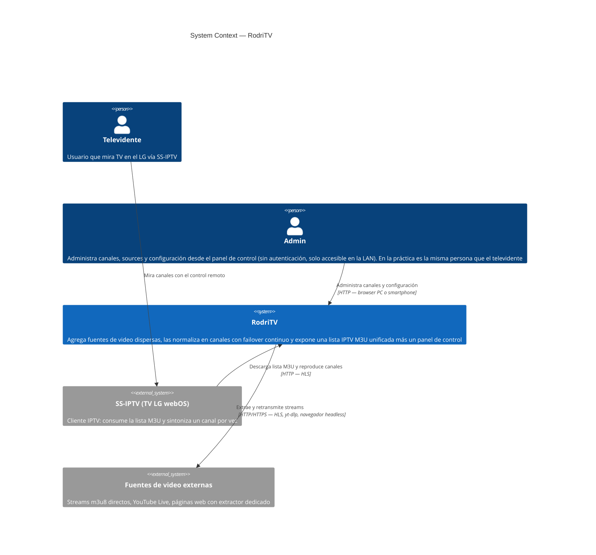
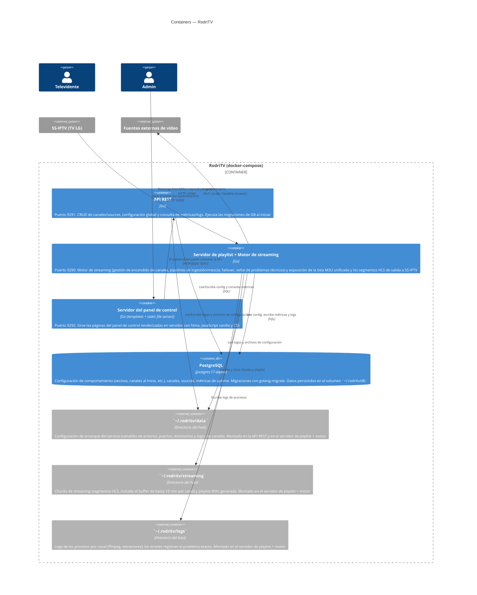
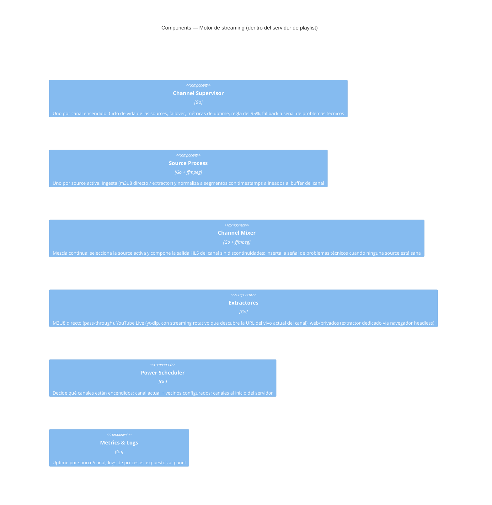

# RFC-001: Motor de streaming con failover continuo para lista IPTV unificada

| Campo | Valor |
|---|---|
| Estado | APPROVED |
| PRD origen | `.sdlc/discovery/PRD.md` (APPROVED, 2026-11-09) |
| Rol | Software Architect |
| Fecha | 2026-11-09 |
| Versión | 0.8 |

## 1. Contexto y problema

El PRD define RodriTV: un agregador hogareño (un solo televidente) que unifica fuentes audiovisualmente dispersas (streams m3u8 directos, YouTube en vivo, páginas web con extractor dedicado) en una única lista IPTV M3U sin autenticación, consumida por SS-IPTV en un TV LG webOS.

Las necesidades centrales que condicionan toda la arquitectura:

- **Conmutación transparente entre sources**: cambiar la señal de un canal de una source a otra sin corte, congelamiento ni salto de audio perceptible en el televisor. La mezcla entre señales es continua.
- **Fluidez sobre actualidad**: buffer configurable de hasta 10 minutos por canal.
- **Señal de "problemas técnicos"** cuando ninguna source del canal funciona, con reintento automático.
- **Encendido acotado de canales**: solo el canal actual (el que se está consumiendo) más N vecinos hacia atrás/adelante, y una cantidad configurable de canales al iniciar el servidor.
- **Gestión adaptativa de sources**: si el uptime de la source principal supera el 95%, las de respaldo se apagan; si cae por debajo, se encienden hasta recuperar el uptime global del canal por encima del 95%.
- **Panel de control web** (PC con layout tipo VSCode, responsivo en Android) para CRUD de canales/sources, configuración global y visualización de logs/métricas.

Métricas objetivo: < 1 interrupción visible por hora y ≥ 95% de uptime por canal en 30 días de uso real.

## 2. Contexto técnico actual

Proyecto **greenfield**: el repositorio solo contiene el scaffold (`go.mod` con Go 1.27.3, módulo `github.com/rodriez/RodriTV`, directorios `cmd/`, `internal/`, `web/`, `deployments/` vacíos). No hay código, dependencias ni documentación de arquitectura previa. Existe una demo técnica que validó la premisa de unificar las fuentes en una lista reproducible por SS-IPTV.

## 3. Arquitectura de la solución — C4

### Nivel 1 — System Context

### Nivel 2 — Containers

Se despliega con **docker-compose** en 4 contenedores (3 de aplicación + PostgreSQL), según lo definido por el usuario:

Decisión clave: el **motor de streaming vive en el mismo binario que el servidor de playlist** (no en la API REST). El ciclo de vida de la playlist y los streams depende directamente del motor — si el motor no corre no hay señal que servir — así que comparten proceso: el servidor de playlist siempre sirve una salida consistente con el estado del motor (señal de problemas técnicos incluida). La API REST queda como un servicio de gestión puro (CRUD, configuración, consulta de métricas), desacoplado del streaming; ambos comparten PostgreSQL como fuente de verdad de la configuración.

**Separación de configuración (sin doble fuente de verdad):**
- `~/.rodritv/data` → **configuración de arranque del servicio**: variables de entorno, puertos, directorios. Se lee una vez al iniciar el contenedor.
- **PostgreSQL** → **configuración de comportamiento del producto**: cantidad de vecinos encendidos, canales al iniciar, canales/sources, buffers, flags. Es lo que el Admin edita desde el panel y aplica en caliente.

### Nivel 3 — Components (motor de streaming)

El motor de streaming (dentro del servidor de playlist) es el componente más complejo y justifica nivel 3:

## 4. Stack y tecnologías

| Capa / necesidad | Tecnología elegida | Justificación |
|---|---|---|
| Lenguaje backend | Go 1.27 | Ya fijado por el proyecto (`go.mod`). Excelente para procesos concurrentes de larga vida (supervisores, pipelines), binario único, bajo consumo — ideal para un server hogareño. |
| Procesamiento de video | **ffmpeg** (proceso externo) | Estándar de facto para ingesta HLS, re-mux, normalización y generación de la salida. Se invoca como subproceso por source/canal, supervisado por Go. |
| Extracción YouTube Live | **yt-dlp** (binario pinneado en la imagen Docker) | Resuelve URLs de streams de YouTube, incluido el descubrimiento del vivo actual de un canal (streaming rotativo). Se actualiza **al rebuildar la imagen** (versión fijada por imagen), de modo que el rollback de imagen también revierte yt-dlp y el arranque no depende de internet. |
| Extracción web/privada | Navegador headless (Chromium vía chromedp), **incluido en la imagen de `rodritv-playlist`** | El PRD contempla sources que "requieren navegador"; chromedp es la opción madura en Go para extraer la URL del stream desde páginas con reproductores JS. Vive en el mismo contenedor que el motor, que es quien lo usa. |
| API REST | `net/http` estándar (ServeMux con patterns de Go 1.27+) | API simple de CRUD; los patterns nativos de método y path param de Go 1.27 cubren el routing sin dependencias externas ni framework. |
| Servidor de playlist/streams | `net/http` estándar | Servir M3U y segmentos HLS es I/O de archivos simple. |
| Persistencia | **PostgreSQL** (`postgres:17-alpine`, contenedor dedicado) | Decisión del usuario. Motor relacional robusto para canales, sources, configuración, métricas de uptime y logs; versión fijada para builds reproducibles. |
| Migraciones de DB | **golang-migrate/migrate** | Decisión del usuario. Migraciones versionadas up/down ejecutadas al iniciar la API, con soporte de reversa para el plan de rollback. |
| Formato de salida al TV | **HLS (M3U8 + segmentos TS)** | SS-IPTV lo reproduce bien en el LG (validado en la demo); es el formato natural para mezclar/bufferar señales con ffmpeg. |
| Frontend panel | **htmx + JavaScript vanilla + CSS**, con templates renderizados en servidor (Go `html/template`) | Decisión del usuario. Sin build de frontend ni framework SPA: páginas renderizadas en servidor con interactividad vía htmx; suficiente para el layout tipo VSCode (3 regiones) y el diseño responsivo, con mucha menos complejidad de tooling. |
| Comunicación panel↔API | HTTP/JSON consumido por el backend del panel; actualizaciones de logs/métricas vía htmx (polling o SSE) | Suficiente para un solo usuario; sin WebSocket si no hace falta. |
| Infraestructura | **docker-compose** (4 contenedores: api, playlist, web, postgres) + directorio `~/.rodritv/` con volúmenes `db`, `data`, `streaming` y `logs` | Definido por el usuario; red local hogareña, sin orquestador. Los datos viven fuera de las imágenes para preservarlos entre versiones. Todos los contenedores con `restart: always` para arrancar con el servidor. |
| Versionado de imágenes | Tags semánticos (`rodritv-api:1.2.3`, etc.) | Requerido por el plan de rollback. |

## 5. Diseño de la solución

### Flujo principal: del stream externo al televisor

1. **Encendido de canales.** El Power Scheduler mantiene el estado "canal actual" (detectado por qué canal está pidiendo segmentos SS-IPTV; al iniciar el servidor se asume el canal 1) y enciende el canal actual + N vecinos hacia atrás y adelante (N configurable). Un canal se considera "actual" con un **TTL de gracia de 30 minutos** desde su última request de segmentos, para no apagar el canal que se está mirando si SS-IPTV deja de pedir segmentos temporalmente. Al iniciar, además, se encienden los primeros M canales (configurable). Los demás canales no consumen recursos.
2. **Ingesta por source.** Cada canal encendido tiene un Channel Supervisor que levanta un Source Process por cada source que deba estar activa:
   - **M3U8 directo:** pass-through/re-mux con ffmpeg, sin extracción.
   - **YouTube Live:** yt-dlp resuelve la URL del stream; con "streaming rotativo" se resuelve periódicamente desde la URL del canal para descubrir el vivo actual.
   - **Web/privada con extractor dedicado:** un extractor (navegador headless) obtiene la URL del stream y luego ffmpeg ingesta normalmente.
   - Cada source tiene su buffer configurable (hasta 10 min a nivel canal) y flag activar/desactivar.
3. **Mezcla continua (failover).** El Channel Mixer compone la salida HLS del canal. Las sources activas llegan a un buffer común con timestamps normalizados; el mixer emite siempre la source de mayor prioridad sana. Ante caída o degradación, conmuta a la siguiente **sin discontinuidad en la playlist de salida** (la numeración de segmentos y los timestamps continúan — el cliente nunca ve un gap). Si ninguna source está sana, el mixer inserta la señal de "problemas técnicos" (un loop de video generado localmente) mientras los Source Processes reintentan en segundo plano.
4. **Regla del 95%.** El supervisor registra uptime por source. Si la source principal supera 95% de uptime, las de respaldo se apagan (los huecos los cubre la señal de problemas técnicos). Si cae por debajo, los respaldos se encienden hasta que el uptime global del canal vuelva a superar el 95%.
5. **Salida al TV.** El contenedor de playlist + motor (:9290) expone:
   - `GET /playlist.m3u` — lista unificada con canales activos, ordenados por su número, con nombre y logo; cada entrada apunta al stream HLS del canal en este mismo servidor.
   - `GET /channels/{n}/...` — playlist y segmentos HLS del canal. La duración de los segmentos es **configurable por canal, 5 segundos por defecto**.
6. **Panel de control.** El servidor del panel (:9292) renderiza las páginas con templates de Go y las enriquece con **htmx + JavaScript vanilla + CSS**: CRUD de canales (nombre, logo, URL de programación opcional, número de orden, habilitado, hasta 5 sources con orden/buffer/flags/tipo de extracción), configuración global (vecinos, canales al inicio) y visualización de logs/métricas por canal (actualizadas por polling/SSE vía htmx). El backend del panel consume la API REST (:9291). Los cambios de configuración aplican en caliente (el scheduler y los supervisores reaccionan sin reinicio).

### Contratos relevantes (a detallar en Specify)

- `API REST`: recursos `channels`, `channels/{id}/sources`, `config`, `channels/{id}/metrics`, `channels/{id}/logs`.
- Playlist M3U con tags `#EXTINF` (nombre, logo, número de canal) compatible con SS-IPTV.
- HLS de salida por canal con secuencia de medios continua, independiente de la fuente activa.

### Decisiones clave y alternativas descartadas

| Decisión | Alternativa descartada | Motivo |
|---|---|---|
| Motor de streaming embebido en el servidor de playlist | Motor en la API REST o en un microservicio separado | Decisión del usuario: el ciclo de vida de la playlist depende directamente del motor de streaming, no de la API. Compartir binario garantiza que lo que se sirve al TV siempre refleje el estado del motor, sin IPC. |
| ffmpeg como subproceso | Binding a libav (cgo) | Menor riesgo, aislamiento de fallos (un crash de ffmpeg no tira el server), reintentos simples. |
| HLS de salida con mezcla en playlist continua | Re-empaquetar todo a un único transcodificador | Transcodificar es caro en hardware hogareño; re-mux + continuidad de playlist logra el failover sin re-encode cuando los perfiles coinciden. |
| PostgreSQL + golang-migrate | SQLite | Decisión del usuario: motor relacional completo con migraciones versionadas; mejor consulta de métricas y camino allanado a v2 multi-usuario. |
| yt-dlp como binario | Librería Go de extracción de YouTube | YouTube cambia constantemente; yt-dlp se actualiza rápido y se mantiene por la comunidad. |
| htmx + templates de Go en el panel | SPA React + Vite | Decisión del usuario: menos tooling y complejidad; el renderizado en servidor con htmx alcanza para el layout tipo VSCode y el responsivo. |

## 6. Problemas y riesgos

| Riesgo | Tipo | Probabilidad | Impacto | Mitigación |
|---|---|---|---|---|
| La mezcla entre sources con perfiles distintos genera glitches al conmutar | Técnico | Media | Alto | **Verificado (2026-11-09):** las fuentes del set inicial que declaran códecs (El Trece, Disney, TyC) usan todas **H.264 + AAC**, por lo que la mezcla por re-mux es viable. La heterogeneidad real está en frame rates (25/29.97/30 fps) y resoluciones: se normalizan timestamps en los límites de segmento. Algunas fuentes no declaran códecs (NeoTV, Cosmos, IPs con token) → sondeo en runtime al activar la source; si el perfil difiere del resto, transcode normalizador solo para esa source. Prueba de aceptación n.º 3 como gate, y primer spike del Plan: PoC del Channel Mixer con 2 sources reales. |
| YouTube cambia y yt-dlp deja de resolver streams | Técnico/operativo | Media | Alto | yt-dlp va pinneado en la imagen; ante una rotura se publica una imagen nueva con la versión corregida (el rollback también revierte yt-dlp). Fallback automático a la siguiente source y a la señal de problemas técnicos. |
| Extractores web (headless browser) frágiles ante cambios de las páginas | Técnico | Alta | Medio | Aislar cada extractor detrás de una interfaz común; métricas de uptime por source detectan la degradación rápido; el failover cubre mientras se arregla. |
| Consumo de CPU/memoria al mantener varios canales + sources encendidos en hardware hogareño | Operativo | Media | Medio | El encendido acotado (actual + vecinos) y la regla del 95% existen justamente para acotar recursos; límites en docker-compose y buffers en disco. |
| Las URLs de streams privados caducan (tokens firmados) | Técnico | Alta | Medio | Los extractores re-resuelven URLs periódicamente; las sources m3u8 con token se tratan como volátiles con refresh automático. |
| Detección incorrecta del "canal actual" (SS-IPTV no notifica) | Técnico | Media | Bajo | Inferir el canal actual por las requests de segmentos del TV; al iniciar, asumir canal 1 (definido en el PRD). **TTL de gracia de 30 minutos**: un canal se considera "actual" hasta 30 min después de su última request, para no apagar el canal que se está mirando si SS-IPTV deja de pedir segmentos temporalmente. |
| Sin autenticación en la lista/panel, cualquier dispositivo de la LAN puede administrar | Negocio/seguridad | Baja | Bajo | Aceptado por el PRD (producto hogareño, red local); documentar que no debe exponerse fuera de la LAN. |

## 7. Plan de rollout

Definido con el usuario:

- Despliegue con **docker-compose** en el servidor hogareño, 4 contenedores:
  - `rodritv-playlist` — motor de streaming + lista M3U y streams HLS, puerto **9290**.
  - `rodritv-api` — API REST de gestión, puerto **9291** (ejecuta las migraciones de DB al iniciar).
  - `rodritv-web` — servidor del panel de control, puerto **9292**.
  - `rodritv-db` — PostgreSQL, accesible solo dentro de la red de compose.
- **Directorio de instalación:** al instalar el sistema se crea `~/.rodritv/` en el home del usuario del host, con cuatro subcarpetas montadas como volúmenes:
  - `~/.rodritv/db` → contenedor PostgreSQL: conserva los datos de la base.
  - `~/.rodritv/data` → contenedores `rodritv-api` y `rodritv-playlist`: logos de canales y archivos de configuración.
  - `~/.rodritv/streaming` → contenedor `rodritv-playlist`: chunks de streaming (segmentos HLS, incluido el buffer de hasta 10 min por canal) y playlist generada.
  - `~/.rodritv/logs` → contenedor `rodritv-playlist`: logs de procesos por canal; los errores registran el problema exacto para su análisis.
- **Arranque automático:** todos los contenedores se configuran con `restart: always` para levantarse siempre que el servidor inicie.
- **Dependencias de arranque (`depends_on` con healthchecks):**
  - `rodritv-api` depende de `rodritv-db` (condición: healthy) — corre las migraciones al iniciar.
  - `rodritv-playlist` depende de `rodritv-db` (healthy) **y de `rodritv-api`** (condición: started tras migraciones aplicadas) — el motor no lee la DB hasta que el esquema está migrado.
  - `rodritv-web` depende de `rodritv-api` (healthy).
- Versionado semántico de imágenes (`x.y.z`); cada release publica las 3 imágenes con el mismo tag.
- Criterio de avance de una versión: desplegar, cargar la lista en SS-IPTV y verificar manualmente frente al televisor los 5 escenarios de aceptación del PRD (reproducción por tipo de source, zapping, failover, caída total, alta de canal desde el smartphone).
- No hay entornos intermedios ni tráfico porcentual: un solo usuario en una LAN.

## 8. Plan de rollback

Definido con el usuario:

- Las imágenes Docker de versiones anteriores quedan disponibles con su tag semántico.
- Rollback = editar los tags en `docker-compose.yml` a la versión anterior y `docker compose up -d`.
- Los datos del sistema viven fuera de las imágenes, en `~/.rodritv/`: la base PostgreSQL en `db/`, logos y archivos de configuración en `data/`, los chunks de streaming en `streaming/` y los logs de procesos en `logs/`. El rollback no destruye datos: al volver a los tags anteriores, los volúmenes se montan igual. Las migraciones se escriben con **golang-migrate** en pares up/down, de modo que ante un rollback se ejecutan las migraciones `down` correspondientes antes de levantar la versión anterior. Los chunks de `streaming/` son efímeros y no requieren reversa.
- Criterio que dispara el rollback: la lista no carga en SS-IPTV, cortes/congelamientos visibles persistentes, o el panel inutilizable tras el despliegue. Responsable de dispararlo: el propio televidente/administrador.

## 9. Alternativas consideradas

- **IPTV-Spark / xTeVe / Threadfin (soluciones existentes)**: gestionan playlists M3U y XMLTV pero no hacen failover transparente con mezcla continua entre sources ni extracción con navegador — la necesidad central del PRD. Descartadas como producto final (útiles como referencia).
- **Pipeline único con transcodificación total (todo pasa por un encoder que genera la salida)**: simplificaría la mezcla pero exige CPU de transcode permanente por canal, inviable en hardware hogareño con varios canales encendidos. Descartada salvo que la normalización por re-mux resulte insuficiente.

## 10. Preguntas abiertas

Sin preguntas abiertas. Decisiones cerradas durante la revisión (2026-11-09):

- **Duración de segmentos HLS de salida:** configurable por canal; **5 segundos por defecto**.
- **Retención de logs:** se persisten en disco en `~/.rodritv/logs` (volumen montado en el contenedor del motor). Los logs —especialmente los de error— deben reflejar el problema exacto ocurrido (proceso, source, salida de ffmpeg/extractor), para poder analizarlo y encontrar soluciones.
- **Materialización del buffer:** en disco, dentro de `~/.rodritv/streaming`.
- **Imagen de PostgreSQL:** `postgres:17-alpine` (versión fijada, no `latest`).
- **Chromium headless:** incluido en la imagen del contenedor `rodritv-playlist` (mismo contenedor que el motor de streaming), no en un contenedor aparte.
- **Actualización de yt-dlp:** la versión va pinneada en la imagen Docker y se actualiza al rebuildar la imagen — el arranque no depende de internet y el rollback de imagen también revierte yt-dlp.
- **Arranque automático:** los contenedores deben arrancar siempre cuando el servidor inicia (política `restart: always` en docker-compose), con `depends_on` + healthchecks para ordenar db → api (migraciones) → playlist (motor) y web.
- **Separación de configuración:** `~/.rodritv/data` guarda la configuración de arranque (variables de entorno, puertos, directorios); PostgreSQL guarda la configuración de comportamiento (vecinos, canales al inicio, canales/sources).
- **Verificación de códecs (2026-11-09):** las fuentes del set inicial que declaran códecs usan H.264 + AAC; la heterogeneidad está en frame rate y resolución. NeoTV, Cosmos y las IPs con token no declaran códecs → sondeo en runtime.
- **TTL del canal actual:** 30 minutos desde la última request de segmentos.

## Historial de estados

| Fecha | Estado | Comentario |
|---|---|---|
| 2026-11-09 | PENDING_REVIEW | Creación a partir del PRD aprobado |
| 2026-11-09 | PENDING_REVIEW | v0.2 — Persistencia cambiada a PostgreSQL (contenedor dedicado) con migraciones golang-migrate; compose pasa a 4 contenedores |
| 2026-11-09 | PENDING_REVIEW | v0.3 — UI del panel cambiada a htmx + JavaScript vanilla + CSS con templates renderizados en servidor (reemplaza SPA React) |
| 2026-11-09 | PENDING_REVIEW | v0.4 — El motor de streaming se mueve al binario del servidor de playlist (:9290); la API REST queda como servicio de gestión puro |
| 2026-11-09 | PENDING_REVIEW | v0.5 — Nuevo actor "Admin" (accede al panel sin autenticación para administrar canales), separado del Televidente en los C4 |
| 2026-11-09 | PENDING_REVIEW | v0.6 — Directorio de instalación `~/.rodritv/` con volúmenes `db` (PostgreSQL), `data` (logos y config, en api + playlist) y `streaming` (chunks, en playlist) |
| 2026-11-09 | IN_REVIEW | El usuario somete el RFC a revisión |
| 2026-11-09 | IN_REVIEW | v0.7 — Preguntas abiertas resueltas: segmentos configurables por canal (5 s por defecto), logs en `~/.rodritv/logs` con detalle exacto del error, buffer en disco, postgres:17-alpine, Chromium en rodritv-playlist, yt-dlp auto-actualizado al arrancar, contenedores con restart: always |
| 2026-11-09 | IN_REVIEW | v0.8 — Evaluación de arquitectura: separación config de arranque (data/) vs comportamiento (PostgreSQL); códecs del set inicial verificados (H.264+AAC); yt-dlp pinneado en imagen; depends_on con healthchecks; TTL de 30 min para el canal actual |
| 2026-11-09 | APPROVED | Revisión completada; queda habilitada la fase Specify (SPECS) |
