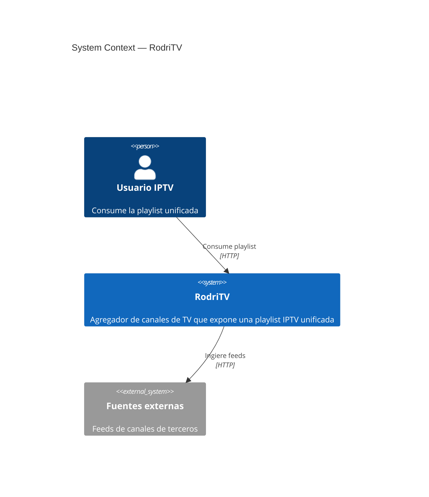
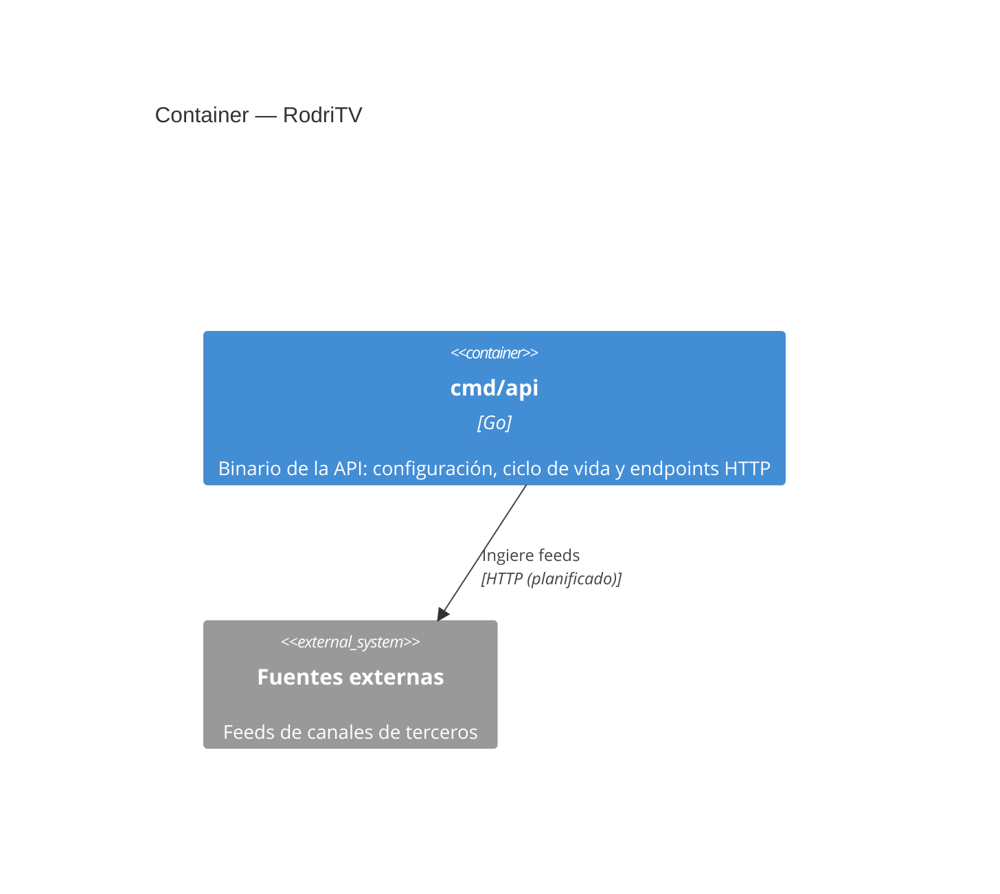
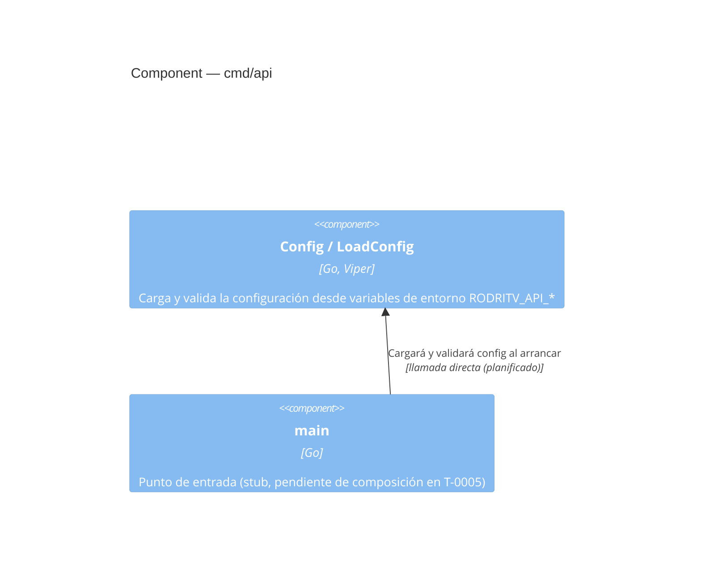

# Architecture — RodriTV

- Fecha de generación: 2026-11-10
- Alcance: repositorio `github.com/rodriez/RodriTV` (módulo `cmd/api`)
- Última actualización: se agrega el binario `cmd/api` con `Config`/`LoadConfig` (Viper) y stub de `main` (T-0001, US-0001).

## System Context

| Elemento | Responsabilidad | Tecnología | Interacciones |
|---|---|---|---|
| RodriTV | Agregador de canales con playlist IPTV unificada | Go 1.27 | HTTP → fuentes externas (inferido del PRD/RFC) |

## Container

| Contenedor | Responsabilidad | Tecnología | Interacciones |
|---|---|---|---|
| cmd/api | Binario de la API (config, arranque, HTTP) | Go 1.27, Viper | HTTP → fuentes externas (planificado, aún sin código) |

## Component — cmd/api

| Componente | Responsabilidad | Tecnología | Interacciones |
|---|---|---|---|
| Config / LoadConfig (cmd/api/config.go) | Struct de configuración y carga con Viper: defaults (`PORT=9291`, `DATA_DIR=/data`, `LOG_LEVEL=info`, `SHUTDOWN_TIMEOUT=10s`), `AutomaticEnv` con prefijo `RODRITV_API`, validación fail-fast (`Validate`) | Go, spf13/viper | Variables de entorno del proceso |
| main (cmd/api/main.go) | Punto de entrada del binario; stub vacío hasta T-0005 | Go stdlib | — |

## Notas / supuestos

- La interacción con fuentes externas y la base de datos PostgreSQL proviene del PRD/RFC; aún no existe código de ingesta ni de persistencia (llega en T-0002/T-0003).
- El servidor HTTP y el endpoint `/healthz` llegan en T-0004; la composición del ciclo de vida en T-0005.
