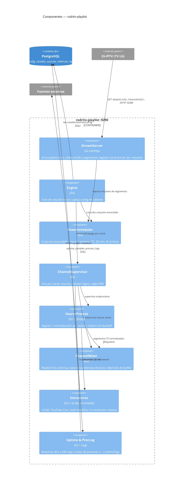

# SPECS-002: rodritv-playlist — Motor de streaming + servidor M3U/HLS

- **RFC de origen:** RFC-001 — Motor de streaming con failover continuo para lista IPTV unificada (APPROVED, `.sdlc/define/RFC-001-streaming-engine-failover-iptv.md`)
- **Proyecto:** `rodritv-playlist` (binario `cmd/playlist`, imagen `rodritv-playlist`, puerto **9290**)
- **SPECS relacionadas:** SPECS-001 (rodritv-api), SPECS-003 (rodritv-web), SPECS-004 (rodritv-infra)
- **Rol:** Tech Lead
- **Estado:** APPROVED
- **Fecha / Versión:** 2026-11-09 / v1.0

## 1. Objetivo técnico

Binario único que contiene (a) el **motor de streaming** — encendido acotado de canales, ingestión de sources vía ffmpeg/extractores, mezcla continua con failover sin discontinuidades en la playlist HLS de salida, señal de "problemas técnicos", regla del 95% de uptime — y (b) el **servidor HTTP** que expone la lista M3U unificada y los streams HLS por canal a SS-IPTV. Lee configuración de comportamiento desde PostgreSQL con aplicación en caliente; escribe métricas de uptime y logs de procesos en PostgreSQL, y logs crudos de procesos en `~/.rodritv/logs`.

## 2. Documentación interna consultada

| Documento | Ubicación | Qué aporta |
|---|---|---|
| Arquitectura de código | — (no existe) | Repo greenfield; se asume layout estándar Go (ver SPECS-002.8 Supuestos) |
| Contratos de APIs actuales | — (no existe) | Se definen aquí los endpoints del puerto 9290 |
| Convenciones y acuerdos | `AGENTS.md` | Stack Go 1.27.3, gofmt/vet, tests con `testing` |

## 3. Arquitectura de código

### Estructura de paquetes

Arquitectura **screaming** según `golang-standards/project-layout`, con **máximo 2 niveles de profundidad** dentro de `internal/`. Un paquete por componente del dominio del motor:

```
cmd/playlist/main.go                # composición e inyección de dependencias manual
cmd/playlist/routes.go              # registro de rutas del ServeMux :9290 (/playlist.m3u, /channels/{n}/..., /logos/, /healthz)
cmd/playlist/config.go              # Viper: env vars, defaults, validación (arranque)
cmd/playlist/server.go              # construcción del http.Server :9290, middleware (logging, recover), ciclo de vida
internal/engine/
  engine.go                         # Engine: raíz del motor; posee scheduler y supervisores; aplica config en caliente
  scheduler.go                      # PowerScheduler: canales encendidos (actual + vecinos, TTL, canales al inicio)
  engine_test.go, scheduler_test.go
internal/supervisor/
  supervisor.go                     # ChannelSupervisor: ciclo de vida de un canal (sources, mixer, regla 95%)
  sourceproc.go                     # SourceProcess: supervisa el subproceso ffmpeg de una source (restart con backoff)
  uptime.go                         # ventana deslizante de uptime; regla del 95%; sampler 30 s
  supervisor_test.go, sourceproc_test.go, uptime_test.go
internal/mixer/
  mixer.go                          # ChannelMixer: playlist HLS continua del canal, failover, retención
  slate.go                          # loop "problemas técnicos" (ffmpeg lavfi, cacheado en disco)
  probe.go                          # sondeo de perfil (ffprobe): decide remux vs transcode
  mixer_test.go, probe_test.go
internal/extractor/
  extractor.go                      # interfaz Extractor + Factory por tipo de source
  m3u8.go                           # pass-through (re-resuelve si URL con token)
  youtube.go                        # yt-dlp: URL del vivo; re-resolución rotativa
  web.go                            # chromedp headless: URL del stream desde página con player JS
  extractor_test.go, m3u8_test.go, youtube_test.go, web_test.go
internal/streamserver/
  handlers.go                       # handlers HTTP: segmentos HLS del canal, logos, /healthz; registro de "canal actual"
  playlist.go                       # M3U maestra (#EXTINF con número, nombre, logo)
  handlers_test.go, playlist_test.go
internal/catalog/                   # dominio de lectura: canales/sources/config desde PostgreSQL
  gateways.go                       # interfaces que el motor consume (definidas por el consumidor)
  postgres.go                       # implementación pgx (usa el código generado por sqlc en este paquete)
  watch.go                          # recarga en caliente de config de comportamiento (polling 15 s)
  postgres_test.go
internal/telemetry/                 # dominio de escritura: uptime_samples y process_logs en PostgreSQL
  gateways.go, postgres.go          # idem catalog (sqlc genera en este paquete)
  postgres_test.go
internal/proclog/
  logger.go                         # logs crudos por canal a ~/.rodritv/logs/canal-<n>-<source>.log (rotación)
internal/platform/
  db.go                             # pgxpool
```

### Modelo de concurrencia

- **`Engine`** (1 goroutine raíz, `errgroup`): posee `PowerScheduler`, mapa `channelID -> *ChannelSupervisor`, y el watcher de config. Aplica diffs: enciende/apaga supervisores sin reiniciar el proceso.
- **`ChannelSupervisor`** (1 goroutine por canal encendido): levanta el `ChannelMixer` del canal y un `SourceProcess` por source activa según su slot (1–5; la principal es la del slot ocupado más bajo y las de slots posteriores actúan como backups, SPECS-001.5.2) y la regla del 95%. Supervisa salud de sources y ejecuta el failover lógico (decide qué source alimenta el mixer).
- **`SourceProcess`** (1 goroutine supervisora + 1 subproceso `ffmpeg` por source activa): ingesta la URL resuelta por el `Extractor` y escribe segmentos TS normalizados en `~/.rodritv/streaming/ch-<n>/src-<id>/`. Restart con backoff exponencial (1 s → 2 → 4 → … → máx. 60 s, con jitter); tras 5 fallos consecutivos marca la source `degraded` y sigue reintentando en background.
- **`ChannelMixer`** (1 goroutine por canal): genera la salida `~/.rodritv/streaming/ch-<n>/index.m3u8` + segmentos finales con **secuencia de medios y programa-date-time monótonos**, independientemente de qué source esté activa (ver SPECS-002.3.1).
- Cancelación por `context.Context` en toda la jerarquía; apagado de un canal = cancelar su contexto y esperar (`WaitGroup`) a que mueran ffmpeg y goroutines. Nunca `goroutine` huérfana: toda goroutine nace bajo un `errgroup` o un supervisor con contexto cancelable.

### 3.1 Mezcla continua (Channel Mixer) — diseño de la continuidad

El mixer **no re-encodea**: re-muxea. La continuidad se logra a nivel playlist, no a nivel bitstream:

1. Cada `SourceProcess` produce segmentos TS **re-muxeados con ffmpeg** (`-c copy`) con duración objetivo = `segment_seconds` del canal (default 5 s) y timestamps normalizados (`-avoid_negative_ts make_zero`, `-muxpreload 0`).
2. Antes de activar una source, `probe.go` ejecuta `ffprobe` sobre la URL resuelta. Si el perfil **no** es H.264+AAC (o difiere en parámetros incompatibles con la source activa), esa source ingesta con **transcode normalizador** (`-c:v libx264 -preset veryfast -c:a aac`) en vez de `-c copy`. Decisión por source, cacheada mientras el proceso viva.
3. El mixer publica la salida del canal: por cada segmento entrante de la source activa lo **copia/renombra** al directorio de salida con índice correlativo propio del canal (`seg-<seq>.ts`) y reescribe `index.m3u8` con `#EXT-X-MEDIA-SEQUENCE` monótona y `#EXT-X-PROGRAM-DATE-TIME` continuo calculado como `anterior + duración` (no el wall-clock de la source). El cliente (SS-IPTV) nunca ve gap, salto atrás de secuencia ni discontinuidad de playlist al conmutar de source.
4. **Failover:** el supervisor marca la source activa como insana (proceso muerto, sin segmentos nuevos en `2×segment_seconds + 2 s`, o error de ffmpeg) → el mixer toma la siguiente source sana por orden de slot y continúa la numeración. Se emite `#EXT-X-DISCONTINUITY` en el límite (los perfiles ya fueron normalizados, así que el TV lo tolera; es la señal estándar HLS para cambio de características).
5. **Slate (problemas técnicos):** si ninguna source está sana, el mixer conmuta a un loop local `slate.ts` (video generado con `ffmpeg -f lavfi` color + texto "Problemas técnicos", H.264+AAC, segmentos de `segment_seconds`), generado una vez por canal y reutilizado. Los `SourceProcess` siguen reintentando; al recuperarse una source sana, el mixer vuelve a ella sin reiniciar secuencia.
6. **Retención:** el mixer mantiene en la playlist los últimos `buffer_minutes * 60 / segment_seconds` segmentos (default 10 min) y borra del disco los que salen de la ventana (también los de sources inactivas).

### 3.2 Power Scheduler

- **Estado "canal actual":** `streamserver` registra en memoria (mapa con mutex) el último timestamp de request de segmentos por canal. El scheduler lo consulta cada 15 s: el canal con request más reciente (y antigüedad < `current_channel_ttl_minutes`, default 30) es el actual; si ninguno, se asume el canal de menor `number` habilitado.
- **Conjunto encendido:** canal actual + `neighbors` (default 2) hacia atrás y adelante en el orden por `number` (solo canales `enabled`), circular en los extremos. Al iniciar el proceso: además, los primeros `startup_channels` (default 3) canales habilitados quedan encendidos hasta que haya un actual detectado.
- Recalcula ante: tick de 15 s, cambio de config en caliente, o cambio en la lista de canales habilitados.

### 3.3 Extractores

```go
type Extractor interface {
    // Resolve devuelve la URL de stream lista para ffmpeg.
    Resolve(ctx context.Context, src Source) (StreamURL, error)
    // RefreshInterval indica cada cuánto re-resolver (0 = no re-resolver).
    RefreshInterval(src Source) time.Duration
}
```

- **`m3u8`:** devuelve la URL tal cual. Si la URL contiene token firmado (query con `token|signature|expires`), `RefreshInterval` = 5 min y re-resuelve con `GET` a la URL origen configurada.
- **`youtube`:** ejecuta `yt-dlp -f best -g <url-canal-o-video>` (binario pinneado en la imagen, SPECS-004). Para "streaming rotativo" (descubrir el vivo actual de un canal): re-resolución con `RefreshInterval` = 10 min contra la URL del canal (`/live`). Timeout de 30 s por invocación; salida parseada por línea.
- **`web`:** chromedp con Chromium headless (en la misma imagen): navega la página, espera el request de red `.m3u8` (network listener), devuelve la URL capturada. Timeout 45 s; una instancia de browser por resolución (aislamiento de fallos), pool máximo 2 browsers concurrentes para acotar memoria.

Las URLs resueltas se cachean por source; el `SourceProcess` pide re-resolución al expirar el intervalo o ante error HTTP 403/404 de ffmpeg.

### 3.4 Regla del 95% (uptime adaptativo)

- `uptime.go` mantiene una ventana deslizante de **1 hora** por source (muestras booleanas cada 5 s: "produjo segmento esperado"). Cada 30 s persiste una muestra agregada en `uptime_samples` (canal, source, ok/total) — consumida por la API (SPECS-001.5.4).
- Si `uptime(source principal) > uptime_threshold` (default 0.95) durante los últimos 15 min → las sources de backup (slots posteriores al de la principal) se apagan (se cancela su `SourceProcess`).
- Si cae por debajo → se encienden backups en orden de slot hasta que el **uptime global del canal** (unión de ventanas: hubo salida de alguna source o del slate) supere el umbral, o no queden backups.
- Histéresis: no se conmuta el estado de backups más de una vez cada 5 min para evitar oscilación.

### 3.5 Diagrama C4 de componentes



### Buenas prácticas aplicadas

Se aplican las reglas no negociables de la skill `go-backend`:

- **Comunicación por interfaces definidas por el consumidor:** `internal/catalog/gateways.go` e `internal/telemetry/gateways.go` declaran las interfaces de persistencia que el motor consume; `postgres.go` las implementa. El motor nunca depende de pgx directamente. *Accept interfaces, return structs*: nunca se retornan interfaces ni punteros innecesarios.
- **Inyección de dependencias manual en `cmd/playlist/main.go`**; el main conoce todas las capas, ninguna capa conoce al main.
- **Standard library primero:** ServeMux, `os/exec`, `context`, `slog`. Dependencias externas justificadas en SPECS-002.4 (pgx/sqlc, Viper, errgroup, chromedp, lumberjack, testify).
- Dependencias externas como **procesos supervisados** (ffmpeg, yt-dlp) o **instancias acotadas** (Chromium), nunca bindings cgo: un crash externo no derriba el server.
- Toda escritura a disco pasa por rutas construidas con `filepath.Join` sobre bases fijas (`streaming/`, `logs/`); nombres de archivos generados internamente (sin input de usuario).
- Config de comportamiento **leída de PostgreSQL cada 15 s** (`internal/catalog/watch.go`) y aplicada por diff — sin reinicio, según RFC §5.6.
- Errores con `%w`; los fallos de procesos externos registran **comando completo, exit code y últimas 50 líneas de stderr** en `process_logs` (DB) y el stderr completo en el archivo de log del canal.

## 4. Decisiones técnicas

| # | Decisión | Alternativas consideradas | Decisión final | Justificación |
|---|---|---|---|---|
| 1 | Procesamiento de video | libav vía cgo, ffmpeg subproceso | **ffmpeg subproceso** (`exec.CommandContext`) | Decisión del RFC: aislamiento de fallos, reintentos simples. |
| 2 | Continuidad HLS entre sources | re-encode único, mezcla en playlist | **Mezcla en playlist** (re-mux por source + reescritura de secuencia en el mixer) | Decisión del RFC: sin CPU de transcode salvo perfil incompatible. |
| 3 | Perfil heterogéneo de sources | transcode siempre, rechazar source | **ffprobe al activar + transcode normalizador condicional** (`-preset veryfast`) | Verificado en el RFC: el set inicial es H.264+AAC; solo pagan transcode las fuentes divergentes. |
| 4 | Slate de problemas técnicos | imagen estática servida, loop generado | **Loop HLS generado con `ffmpeg -f lavfi`** (color + texto, cacheado en `streaming/slate/`) | Mismo perfil y duración de segmento que el canal → conmutación sin discontinuidad de cliente. |
| 5 | Detección de canal actual | header del cliente, por requests de segmentos | **Última request de segmentos + TTL 30 min** | Decisión del RFC (SS-IPTV no notifica nada). |
| 6 | Config en caliente | señales SIGHUP, watch de archivo, polling DB | **Polling a PostgreSQL cada 15 s** (`internal/catalog/watch.go`) | PostgreSQL es la fuente de verdad del comportamiento (RFC §2); polling simple y suficiente para un usuario. |
| 7 | Acceso a datos | queries manuales, ORM | **sqlc** (solo lectura de config/canales + escritura de métricas/logs); queries fuente en `scripts/sqlc/` (catalog.sql, telemetry.sql), código `.go` generado en los paquetes `catalog`/`telemetry`; mismas migraciones y esquema que SPECS-001.6 | Decisión del usuario; comparte esquema con la API. |
| 8 | Supervisión de goroutines | canales manuales | **`golang.org/x/sync/errgroup`** + contextos jerárquicos | Propagación de errores y cancelación estructurada; estilo idiomático. |
| 9 | Extracción YouTube | librería Go | **yt-dlp binario pinneado en imagen**, re-resolución cada 10 min | Decisión del RFC: YouTube cambia seguido; el pinneo hace reproducible el build y el rollback. |
| 10 | Extracción web | colly/scrape HTML, chromedp | **chromedp + Chromium headless** en la imagen, pool máx. 2 | Players JS requieren navegador real; pool acotado por memoria (RFC: hardware hogareño). |
| 11 | Logs de procesos | solo DB, solo archivos | **Doble salida:** stderr completo a `~/.rodritv/logs/` (rotación 10 MB × 3) + resumen estructurado a `process_logs` | Decisión del RFC §10: los errores deben reflejar el problema exacto; el panel consulta la DB. |
| 12 | Rotación de logs de procesos | lumberjack, logrotate | **lumberjack** (`gopkg.in/natefinch/lumberjack.v2`) | Rotación en-proceso, sin depender de logrotate del host en el contenedor. |
| 13 | M3U maestra | generada en disco por ticker, renderizada por request | **Renderizada en memoria por request** (lista de canales cacheada 15 s) | Siempre consistente con la DB; el archivo en `streaming/` no es necesario. |

## 5. Contratos de API (puerto 9290)

Consumidor: SS-IPTV. Sin JSON; formatos M3U/HLS. Todas las rutas responden `200` o `404` (`X-Reason` header informativo en 404).

| Método | Ruta | Descripción |
|---|---|---|
| GET | `/playlist.m3u` | Lista maestra: `#EXTM3U` + una entrada `#EXTINF:-1 tvg-chno="{number}" tvg-name="{name}" tvg-logo="{logoURL}",{name}` por canal `enabled`, ordenada por `number`; la URL de cada entrada es `http://<host>:9290/channels/{number}/index.m3u8` |
| GET | `/channels/{n}/index.m3u8` | Playlist HLS del canal `n` (media playlist con `#EXT-X-MEDIA-SEQUENCE` continua; versión 3) |
| GET | `/channels/{n}/seg-{seq}.ts` | Segmento TS de salida del canal |
| GET | `/logos/{filename}` | Logo desde `~/.rodritv/data/logos` (mismo criterio anti path-traversal que SPECS-001) |
| GET | `/healthz` | `200` si DB responde y el Engine está corriendo; `503` si no |

Notas de contrato:
- Pedir `index.m3u8` de un canal **apagado** lo marca como "actual" (request de segmentos) y el scheduler lo encenderá en ≤ 15 s; mientras tanto se sirve el `index.m3u8` del slate con `Retry-After: 5` implícito en la cadencia de la playlist (SS-IPTV reintenta solo).
- `#EXT-X-TARGETDURATION` = `segment_seconds` del canal; `#EXTINF` real medido por segmento.
- Los logos referenciados usan URL absoluta del propio servidor (`/logos/...`).

## 6. Persistencia, integraciones y proveedores

- **PostgreSQL:** lee `channels` (con `sources` JSONB embebido) y `config`; escribe `uptime_samples` (insert cada 30 s por source activa) y `process_logs` (insert por evento warn/error). Pool `pgxpool` chico (max 5). Esquema en SPECS-004.6.
- **Filesystem:**
  - `~/.rodritv/streaming/` → `ch-<number>/index.m3u8`, `ch-<number>/seg-*.ts` (salida), `ch-<number>/src-<id>/*.ts` (ingesta), `slate/` (loops generados). Limpieza al apagar canal y pruning por retención (SPECS-002.3.1.6).
  - `~/.rodritv/logs/` → `canal-<number>-src-<id>.log` por proceso, rotación lumberjack.
  - `~/.rodritv/data/logos/` → solo lectura.
- **Binarios externos (en la imagen, SPECS-004):** `ffmpeg`, `ffprobe`, `yt-dlp` (versión pinneada), `chromium` (headless, flags `--no-sandbox --headless=new --disable-gpu`).
- **Variables de entorno (Viper, prefijo `RODRITV_PLAYLIST_`):**

| Var | Default | Descripción |
|---|---|---|
| `PORT` | `9290` | Puerto HTTP |
| `DATABASE_URL` | — (requerida) | DSN PostgreSQL |
| `STREAMING_DIR` | `/streaming` | Raíz de `~/.rodritv/streaming` |
| `DATA_DIR` | `/data` | Raíz de `~/.rodritv/data` (logos) |
| `LOGS_DIR` | `/logs` | Raíz de `~/.rodritv/logs` |
| `FFMPEG_PATH` / `FFPROBE_PATH` / `YTDLP_PATH` / `CHROMIUM_PATH` | autodetect en `$PATH` | Rutas de binarios externos |
| `CONFIG_POLL_INTERVAL` | `15s` | Recarga de config de comportamiento |
| `LOG_LEVEL` | `info` | Nivel slog |
| `SHUTDOWN_TIMEOUT` | `15s` | Graceful shutdown (mata ffmpeg hijos) |

## 7. Estrategia de testing

**TDD obligatorio** (skill `go-backend`): red → green → refactor por caso de uso. Assertions con `testify/assert` + `testify/require`.

- **Caja negra:** cada componente se testea por su comportamiento observable vía su interfaz pública.
- **Mocks solo en los extremos** con `testify/mock`. Los extremos de esta SPECS son: persistencia (interfaces de `catalog`/`telemetry`), procesos externos (ffmpeg/ffprobe/yt-dlp, vía comando fake), Chromium, el reloj (interfaz `Clock` para determinismo) y el filesystem (directorios `t.TempDir()`).
- **`PowerScheduler`:** unit tests puros (conjunto encendido ante distintos vecinos, TTL, canales habilitados, circularidad en extremos, canales al inicio), con `Clock` fake.
- **`ChannelMixer`:** unit/integration con segmentos TS sintéticos generados por ffmpeg en test: continuidad de `MEDIA-SEQUENCE` y `PROGRAM-DATE-TIME` al conmutar de source, inserción de slate, retención/pruning, `EXT-X-DISCONTINUITY` en el límite.
- **`uptime.go`:** ventana deslizante, regla del 95% con histéresis (`Clock` fake para determinismo).
- **`SourceProcess`:** ffmpeg fake (script shell que emula éxito/fallo/lentitud) verificando backoff, marcado `degraded` y cancelación por contexto.
- **Extractores:** `m3u8` unit puro; `youtube` y `web` con binarios fake (script que emula salida de yt-dlp) y servidor httptest para chromedp (test de integración, tag `integration`).
- **`streamserver`:** httptest: formato de la M3U maestra (tags SS-IPTV), 404 de canal inexistente, servicio de segmentos y logos, registro de "canal actual".
- **`catalog`/`telemetry` (implementación sqlc):** testcontainers-go con migraciones reales (igual que SPECS-001.7).
- **Cobertura objetivo:** ≥ 80% en la lógica de negocio (`engine`, `supervisor`, `uptime`), ≥ 70% en `mixer` y `streamserver`.
- **Prueba de aceptación manual (gate del RFC):** PoC del mixer con 2 sources reales antes de cerrar la implementación del mixer (riesgo n.º 1 del RFC).

## 8. Supuestos

- Repo greenfield: convenciones estándar Go asumidas; sin documentación interna previa.
- Los perfiles H.264+AAC del set inicial hacen que el camino `-c copy` sea el dominante; el transcode normalizador es excepción (RFC §6, verificado).
- SS-IPTV tolera `#EXT-X-DISCONTINUITY` y reintenta playlists; validado parcialmente en la demo del PRD, se confirma en la prueba de aceptación n.º 3 del RFC.
- Versiones exactas de librerías vía `go mod tidy` en Implement; major versions indicadas son objetivo.

## 9. Riesgos y bloqueantes

Sin bloqueantes. Riesgos heredados del RFC (§6) con su tratamiento en esta SPECS:

| Riesgo | Tratamiento |
|---|---|
| Glitches al conmutar sources con perfiles distintos | SPECS-002.3.1.2 (ffprobe + transcode condicional) + PoC del mixer como primer spike del Plan |
| yt-dlp roto por cambios de YouTube | Pinneo en imagen + fallback automático (SPECS-002.3.3) |
| Extractores web frágiles | Interfaz `Extractor` aislada (SPECS-002.3.3) + métricas por source |
| Consumo de recursos en hardware hogareño | Encendido acotado (SPECS-002.3.2), regla 95% (SPECS-002.3.4), pool Chromium máx. 2, límites en compose (SPECS-004) |
| URLs con token caducables | Re-resolución periódica y ante 403/404 (SPECS-002.3.3) |
| Detección incorrecta del canal actual | TTL 30 min + fallback al canal 1 (SPECS-002.3.2) |

## 10. Tabla de proyectos afectados

| Proyecto | Tipo | Cambios de la SPECS que aplica | Secciones |
|---|---|---|---|
| rodritv-playlist | nuevo | Todo el servicio: motor, extractores, mixer, servidor HLS | 3–6 |
| rodritv-infra | nuevo | Imagen con ffmpeg/yt-dlp/Chromium pinneados, volúmenes streaming/logs/data | 6 (detalle en SPECS-004) |

## 11. Fuera de alcance

- CRUD de canales/sources/config (API, SPECS-001) y UI (SPECS-003).
- Autenticación en el puerto 9290 (LAN, decisión del PRD).
- Transcodificación permanente de todos los canales (descartada en el RFC §9).
- Grabación/timeshift persistente más allá del buffer de retención.
- EPG/XMLTV (no está en el RFC).
