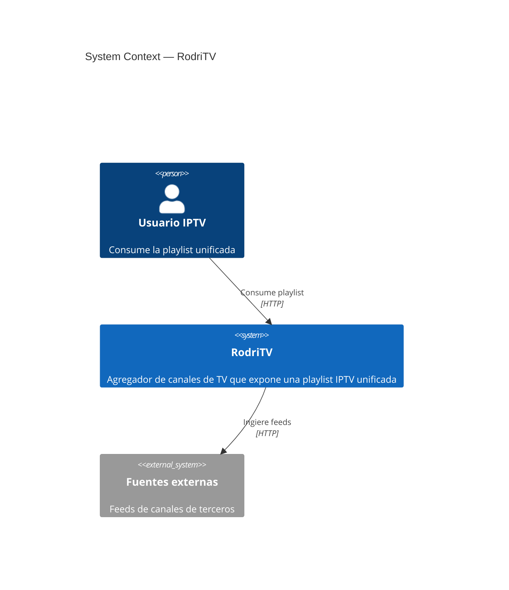
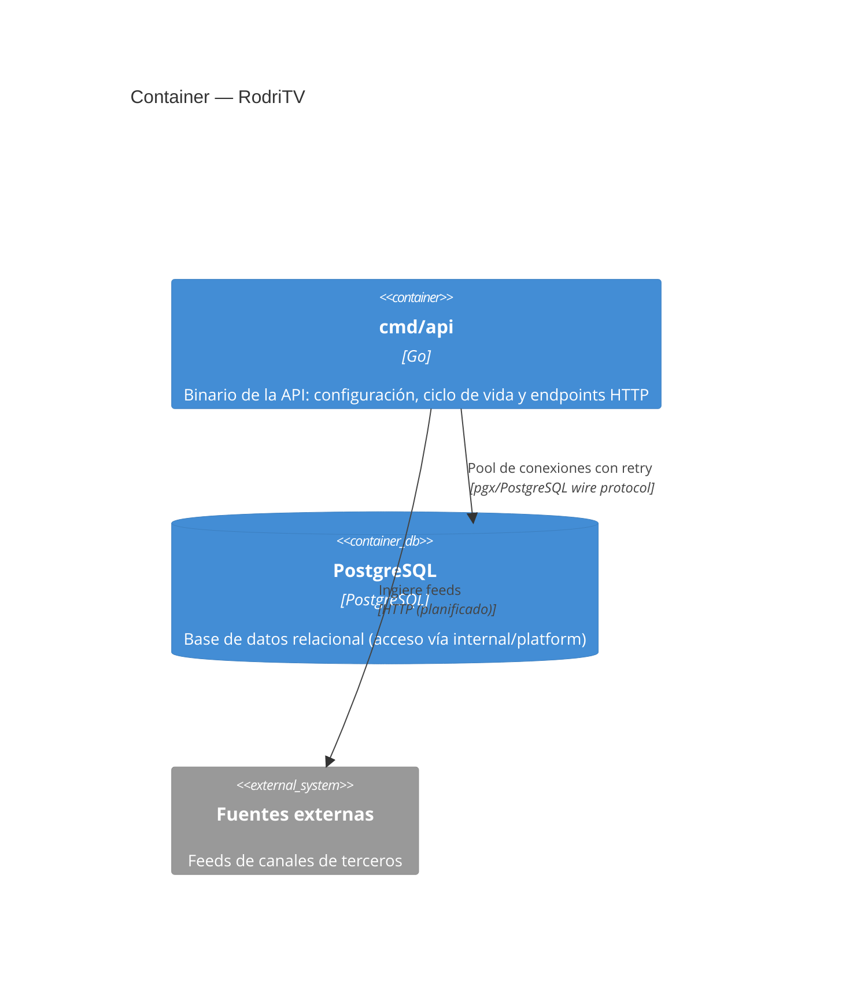
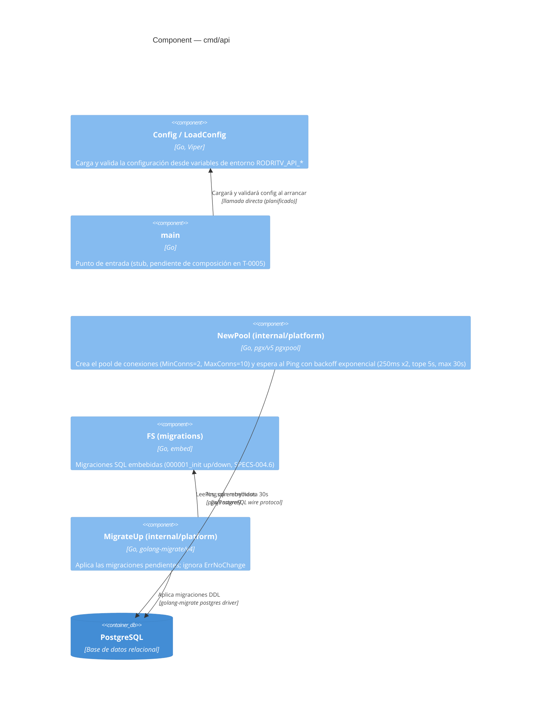

# Architecture — RodriTV

- Fecha de generación: 2026-11-10
- Alcance: repositorio `github.com/rodriez/RodriTV` (módulo `cmd/api`)
- Última actualización: se agrega el paquete `migrations` (SQL `000001_init` embebido vía `FS`) y `MigrateUp` en `internal/platform` (runner golang-migrate iofs+postgres, T-0003, US-0001).

## System Context

| Elemento | Responsabilidad | Tecnología | Interacciones |
|---|---|---|---|
| RodriTV | Agregador de canales con playlist IPTV unificada | Go 1.27 | HTTP → fuentes externas (inferido del PRD/RFC) |

## Container

| Contenedor | Responsabilidad | Tecnología | Interacciones |
|---|---|---|---|
| cmd/api | Binario de la API (config, arranque, HTTP) | Go 1.27, Viper, pgx/v5 | pgx → PostgreSQL; HTTP → fuentes externas (planificado) |
| PostgreSQL | Persistencia relacional | PostgreSQL | ← pgxpool (MinConns=2, MaxConns=10) desde `internal/platform` |

## Component — cmd/api

| Componente | Responsabilidad | Tecnología | Interacciones |
|---|---|---|---|
| Config / LoadConfig (cmd/api/config.go) | Struct de configuración y carga con Viper: defaults (`PORT=9291`, `DATA_DIR=/data`, `LOG_LEVEL=info`, `SHUTDOWN_TIMEOUT=10s`), `AutomaticEnv` con prefijo `RODRITV_API`, validación fail-fast (`Validate`) | Go, spf13/viper | Variables de entorno del proceso |
| main (cmd/api/main.go) | Punto de entrada del binario; stub vacío hasta T-0005 | Go stdlib | — |
| NewPool (internal/platform/db.go) | Pool pgx con `MinConns=2`/`MaxConns=10`; `Ping` con backoff exponencial (inicio 250ms, ×2, tope 5s) hasta 30s; devuelve error si se agota el tiempo o se cancela el contexto | Go, jackc/pgx/v5 pgxpool, log/slog | pgx → PostgreSQL |
| FS (migrations/migrations.go) | `embed.FS` con las migraciones SQL (`000001_init.up.sql` / `000001_init.down.sql`, DDL de SPECS-004.6) | Go, embed | leído por `MigrateUp` vía iofs |
| MigrateUp (internal/platform/migrate.go) | Aplica todas las migraciones pendientes del FS embebido; ignora `migrate.ErrNoChange` (retorna nil), propaga el resto de errores | Go, golang-migrate/migrate/v4 (iofs + postgres) | DDL → PostgreSQL |

## Notas / supuestos

- La interacción con fuentes externas proviene del PRD/RFC; aún no existe código de ingesta.
- El servidor HTTP y `/healthz` llegan en T-0004; la composición del ciclo de vida en T-0005.
