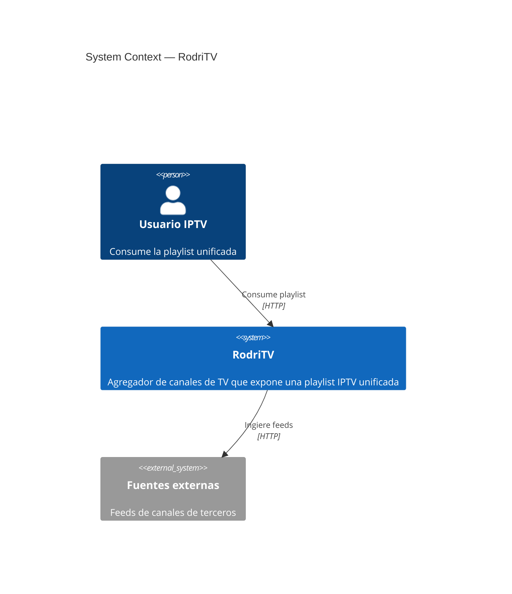
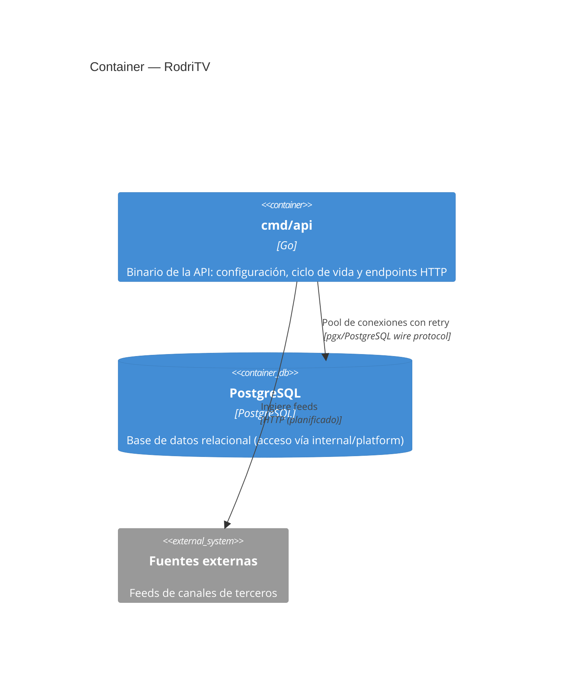
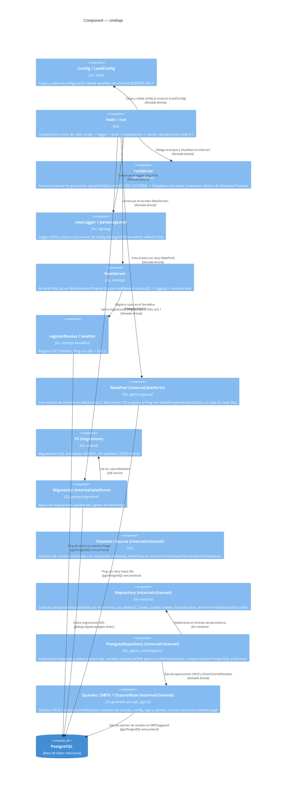

# Architecture — RodriTV

- Fecha de generación: 2026-11-10
- Alcance: repositorio `github.com/rodriez/RodriTV` (módulo `cmd/api`)
- Última actualización: se agrega `PostgresRepository` (T-0009, US-0002), implementación de `Repository` sobre las queries sqlc y `pgx`, con serialización JSONB, reloj inyectable y mapeo de errores de persistencia al dominio.

## System Context

| Elemento | Responsabilidad | Tecnología | Interacciones |
|---|---|---|---|
| RodriTV | Agregador de canales con playlist IPTV unificada | Go 1.27 | HTTP → fuentes externas (inferido del PRD/RFC) |

## Container

| Contenedor | Responsabilidad | Tecnología | Interacciones |
|---|---|---|---|
| cmd/api | Binario de la API (config, arranque, HTTP) | Go 1.27, Viper, pgx/v5 | pgx → PostgreSQL; HTTP → fuentes externas (planificado) |
| PostgreSQL | Persistencia relacional | PostgreSQL | ← pgxpool (MinConns=2, MaxConns=10) desde `internal/platform` |

## Component — cmd/api

| Componente | Responsabilidad | Tecnología | Interacciones |
|---|---|---|---|
| Config / LoadConfig (cmd/api/config.go) | Struct de configuración y carga con Viper: defaults (`PORT=9291`, `DATA_DIR=/data`, `LOG_LEVEL=info`, `SHUTDOWN_TIMEOUT=10s`), `AutomaticEnv` con prefijo `RODRITV_API`, validación fail-fast (`Validate`) | Go, spf13/viper | Variables de entorno del proceso |
| main / run (cmd/api/main.go) | Composición del binario: `LoadConfig` → logger slog JSON → `platform.NewPool` → `platform.MigrateUp` (error ≠ `ErrNoChange` → exit 1) → `NewServer` → `runServer`; inyección manual de dependencias, sin frameworks DI | Go stdlib, os/signal | orquesta todos los componentes; devuelve exit code 0/1 |
| runServer (cmd/api/main.go) | Arranca `ListenAndServe` en goroutine; `signal.NotifyContext(SIGINT, SIGTERM)` dispara `Shutdown` drenando conexiones en vuelo dentro de `ShutdownTimeout`; errores de arranque se propagan | Go, net/http, os/signal | señales del SO → graceful shutdown |
| newLogger / parseLogLevel (cmd/api/main.go) | Logger `slog` JSON a stdout con el nivel de `Config.LogLevel` (desconocido → info) | Go, log/slog | usado por toda la cadena de middleware y handlers |
| NewServer (cmd/api/server.go) | Construye el `http.Server` (ReadHeader 5s, Read 10s, Write 30s, Idle 120s) sobre el ServeMux envuelto en middleware: `requestID` (genera/propaga `X-Request-ID`), `logging` (slog JSON con `request_id`, `method`, `path`, `status`, `duration_ms`), `recoverPanic` (panic → 500 uniforme + stack en log) | Go, net/http, log/slog, google/uuid | compone `registerRoutes` |
| registerRoutes / healthz (cmd/api/routes.go) | Registra `GET /healthz`: ejecuta `Ping` (timeout 2s) contra la interfaz `Pinger` (la satisface `*pgxpool.Pool`); 200 `{"status":"ok"}` o 503 `{"status":"unavailable"}` | Go, net/http ServeMux | pgx Ping → PostgreSQL |
| writeError / writeJSON (cmd/api/server.go) | Mapeo uniforme de errores con `errors.Is/As`: validación → 400 `validation` (con `fields`), `not_found` → 404, `conflict` → 409, resto → 500 `internal` (sin filtrar el mensaje interno). JSON siempre `application/json; charset=utf-8` | Go, encoding/json | consumido por todos los handlers |
| NewPool (internal/platform/db.go) | Pool pgx con `MinConns=2`/`MaxConns=10`; `Ping` con backoff exponencial (inicio 250ms, ×2, tope 5s) hasta 30s; devuelve error si se agota el tiempo o se cancela el contexto | Go, jackc/pgx/v5 pgxpool, log/slog | pgx → PostgreSQL |
| FS (migrations/migrations.go) | `embed.FS` con las migraciones SQL (`000001_init.up.sql` / `000001_init.down.sql`, DDL de SPECS-004.6) | Go, embed | leído por `MigrateUp` vía iofs |
| MigrateUp (internal/platform/migrate.go) | Aplica todas las migraciones pendientes del FS embebido; ignora `migrate.ErrNoChange` (retorna nil), propaga el resto de errores | Go, golang-migrate/migrate/v4 (iofs + postgres) | DDL → PostgreSQL |
| Channel / Source (internal/channel/entity.go, source.go) | Dominio de canales: `Channel` (5 slots fijos de `*Source`, serialización JSON con nulls) y `Source` con invariantes en `Validate` (`Number`>0, `Name` 1–100, `SegmentSeconds` 2–10, `ScheduleURL` http(s) opcional, `Slot` 1–5 = posición, `URL` http(s)); `NewChannel` aplica defaults (habilitado, `SegmentSeconds=5`). Errores: sentinelas `ErrNotFound`/`ErrConflict` y tipado `ErrValidation{Field, Msg}` (con `ValidationFields()` para el mapeo HTTP) | Go, google/uuid | sin dependencias ni consumidores aún (hasta T-0010) |
| Repository (internal/channel/gateways.go) | Interfaz de salida del dominio hacia la persistencia, definida por el consumidor: `List` (ordenada por `number`), `GetByID`, `Create`, `Update`, `Delete`, `ExistsNumber` (excluye un ID para conflicto 409). Contratos de error documentados: `ErrNotFound` en GetByID/Update/Delete, `ErrConflict` en Create/Update | Go interface, google/uuid | implementada por `PostgresRepository` |
| PostgresRepository (internal/channel/postgres.go) | Repositorio PostgreSQL: UUID v4 y timestamps UTC con reloj inyectable; `sources` serializado como array JSONB de 5 posiciones; SQLSTATE 23505 de `number` → `ErrConflict`, no rows/0 filas → `ErrNotFound` | Go, pgx/v5, encoding/json | queries sqlc → PostgreSQL |
| Queries / DBTX / ChannelRow (internal/channel) | Código generado por sqlc desde `scripts/sqlc/channel.sql`: operaciones CRUD, `ExistsChannelNumber`, modelos de tablas y abstracción `DBTX` compatible con pgx; `ChannelRow` evita colisión con la entidad `Channel` | Go, sqlc v1.30.0, pgx/v5 | consumido por `PostgresRepository`; pgx → PostgreSQL |

## Notas / supuestos

- La interacción con fuentes externas proviene del PRD/RFC; aún no existe código de ingesta.
- Los errores de dominio (`ErrNotFound`, `ErrConflict`, `ErrValidation`) ya existen en `internal/channel/entity.go` (T-0006); `writeError` aún usa placeholders provisionales en `cmd/api/server.go` hasta que lleguen los handlers (US-0003).
